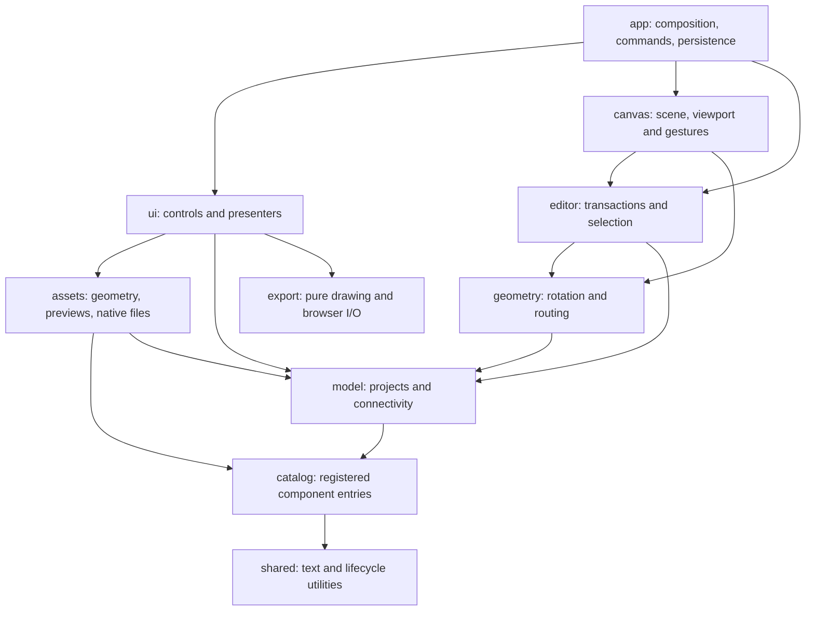

# WirePad architecture

WirePad runs as native browser modules on a static site. There is no runtime server, bundler or application dependency. `src/main.js` mounts `createApplication()` from `src/app/bootstrap.js` and exposes the mounted application for local inspection.

## Ownership and dependencies



The model, geometry, catalog and native asset layers have no DOM dependencies. A family cannot import another family's implementation; shared board builders and contact layouts have separate owners. `test/architecture.test.mjs` checks import resolution, dependency cycles, these boundaries and that every shipped module is reachable from the browser entry.

- `app/` owns startup, shared commands, persistence and preferences. It wires callbacks explicitly and coordinates destruction.
- `model/` owns version-1 project records, limits, history snapshots, contact lookup, configuration resolution, names, endpoint identity and electrical continuity. Storage/recovery remains an application service.
- `editor/` commits atomic changes and owns selection/movement and wire transactions. It calls shared geometry rather than reimplementing rotation or endpoint transforms.
- `geometry/` owns part transforms/bounds, endpoint positions, orthogonal routes and obstacle routing.
- `canvas/scene.js` and `canvas/markup.js` produce pure scene geometry and SVG. `layers.js` reconciles DOM layers; `viewport.js` handles projection; `input.js`, `targets.js` and `keyboard.js` own gestures and input arbitration.
- `ui/` owns library cards, Inspector providers, dialogs, keyboard/toolbar actions and workspace presentation. Names come from the model rather than a renderer. Feature styles are under `ui/styles/`; root `style.css` preserves their cascade order.
- `assets/` owns symbol, footprint and model geometry. `previews.js` and `kicad.js` consume those same layouts. No asset generator switches on a board's component ID.
- `export/drawing.js` creates SVG and raster dimensions without browser APIs. `export/browser.js` owns downloads, rasterization, object URLs and clipboard timing.

## Adding a family

Run:

```sh
node scripts/new-family.mjs my-family
```

The scaffold stays unregistered until reviewed entries are supplied. Each entry is one record:

```js
import { defineFamily } from '../registry.js';

export default defineFamily('my-family', [{
  component,       // Identity, source/revision, dimensions and physical contacts.
  render,          // (resolvedComponent, showLabels) => self-contained SVG markup.
  footprint,       // Physical/reference geometry, or a function of the resolved component.
  model,           // Optional labeled manufacturer CAD URL.
  configuration,   // Optional configurable-instance contract.
}]);
```

Add its default import and one list entry to `src/catalog/catalog-families.js`. Ordering there controls library ordering. Consumers import `components`, `componentById`, `componentArt`, `footprintDefinitionFor`, `modelFor` and `configurationFor` from `src/catalog/index.js`.

`defineFamily()` checks identities, dimensions, contact positions/types, internal connections, footprint references and CAD metadata. `createCatalog()` indexes entries by stable component ID. Artwork keys can be reused; renderer ownership is per entry. The component's existing `art` metadata remains stable.

Define pads and canvas anchors from the same physical coordinates. Interior contacts need `surface: true`, and the component needs `contactLayout: 'physical'`. Dense sockets can use printed terminal numbers and hover descriptions. Hidden faces must be separately labeled. Repeated physical lands retain the same electrical terminal number and pin ID.

Use builders in `catalog/shared/` for related boards. `catalog/parts/` holds individual definitions used by a family. Large generated vector assets belong in `catalog/artwork/`, with readable part data, original CAD references and licensing in `catalog/data/`. The importing family keeps the definition, artwork and footprint together as one entry.

Run `node scripts/catalog.mjs` to check all registered entries, both art modes and exact contact-to-footprint coverage. Use `--json` for a machine-readable report. Then review the rendered part, connect it on the canvas, export an image and inspect its native KiCad files. A scaffold does not establish a verified hardware pinout.

## Configurable parts

A configurable entry supplies:

```js
configuration: {
  key: 'breadboard',
  normalize: normalizeBreadboardConfig,
  create: createBreadboard,
}
```

The key names the persisted instance field. The resolver normalizes settings, caches resolved instances by component/configuration and supplies the same resolved geometry to drawing, routing, continuity and exports. The project parser and `editor.configurePart()` use this descriptor without board-specific branches. Core project fields cannot be configuration keys.

Add the corresponding controls to the provider map in `ui/inspector/configuration.js`. Providers render and read configuration only; the controller delegates validation and history changes to the editor.

Breadboards support 1–100 terminal rows, independent 1–10-cell left/right banks, 0–4 rails per side and split rails. Old projects receive five cells per bank. Existing A–E/F–J contact identities remain stable; additional left contacts use K–O and additional right contacts use P–T. Resizing changes the right bank's physical offset while retaining those identities. Removing a wired contact is rejected.

## Container movement and selection

A surface board acts as a wiring container. Border/caption drags move the board, wholly contained parts and junctions, and interior routing points. External endpoints stay fixed. Crossing wires with no internal attachment or waypoint remain independent. The movement planner clips routes at container boundaries, shares one bounded translation and commits one history step; undo restores the original snapshot.

Interior face drags begin a marquee. Surface boards require full enclosure even for a crossing marquee, so partial internal-wire selections exclude their board. Ctrl/Command toggles individual items; adding/removing a selection does not start a drag. Keyboard nudges use the same movement plan.

## Lifecycle

`createScope()` owns event subscriptions, cleanups and timers. Each mounted UI/canvas controller returns `destroy()`. The application destroys scopes and controllers, disconnects observers and removes its SVG layers/icons before remounting. Queued imports and clipboard operations cannot update a destroyed controller. Remount tests and browser checks ensure a single action still creates one edit.

## Static assets and serving

`node scripts/serve.mjs [port]` serves only the static application locally, disables caching and rewrites asset URLs into `/assets/local/` so the HTML, styles and modules reload together.

`node scripts/build-site.mjs <outdir> <revision>` packages one versioned asset namespace. The GitHub Pages workflow uses this same builder. Browser module imports and CSS imports remain relative inside that namespace. Static-site tests check the packaged dependency graph and URL mapping.

## Compatibility and verification

Saved projects retain version 1, component/pin IDs, storage and recovery keys, and default canvas geometry. `test/fixtures/catalog-geometry.json` guards the 502 previously published definitions. Adding a component does not require rewriting that fixture; moving a published anchor requires a deliberate migration.

The refactor was checked against before/after fingerprints for every component, both SVG modes, normalized footprints and native files. The authorized breadboard feature changes its description/configuration metadata; its default contact coordinates and artwork remain identical. The ESP32-S3 footprint now declares its header groups locally; its generated native geometry is unchanged.

The test suite covers import/history recovery, electrical nets, rotations, route edits, selection/containers, UI lifecycle, catalog validation, downloads and static packaging. Browser checks cover imports, filters, asset tabs, repeated mount/destroy, responsive/touch layouts and the requested breadboard interactions. Native KiCad checks are recorded separately from browser visual checks.
