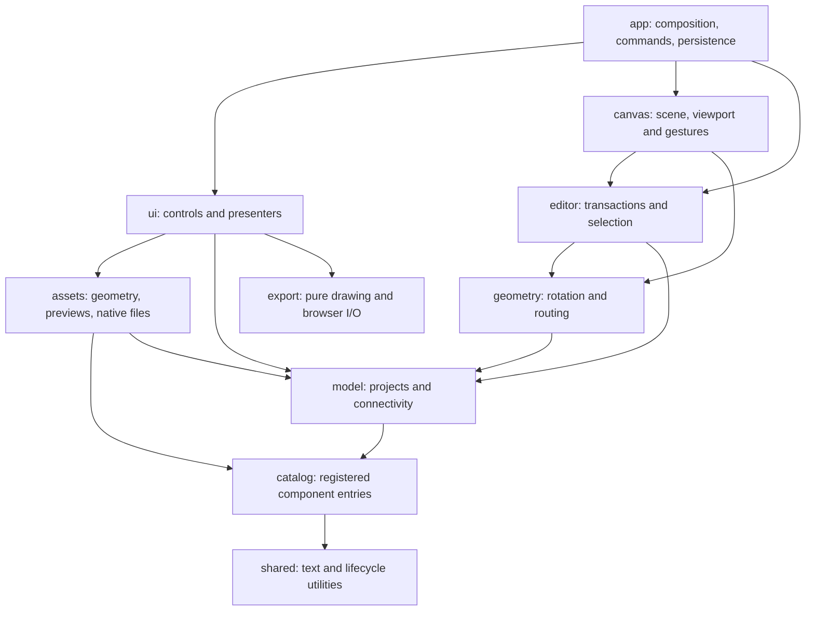

# WirePad architecture

WirePad runs as native browser modules on a static site. There is no runtime server, bundler or application dependency. `src/main.js` mounts `createApplication()` from `src/app/bootstrap.js` and exposes the mounted application for local inspection.

## Ownership and dependencies



The model, geometry, catalog and native asset layers have no DOM dependencies. A family cannot import another family's implementation; shared board builders and contact layouts have separate owners. Consumers outside the catalog use `catalog/index.js`, including library filtering. `test/architecture.test.mjs` checks import resolution, dependency cycles, these boundaries and that every shipped module is reachable from the browser entry.

- `app/` owns startup, shared commands, persistence and preferences. It wires callbacks explicitly and coordinates destruction.
- `model/` owns project records, version-1 import migration, limits, history snapshots, contact lookup, configuration resolution, names, endpoint identity and electrical continuity. Storage/recovery remains an application service.
- `editor/` commits atomic changes and owns selection/movement and wire transactions. It calls shared geometry rather than reimplementing rotation or endpoint transforms.
- `geometry/` owns part transforms/bounds, endpoint positions, orthogonal routes and obstacle routing.
- `canvas/scene.js` and `canvas/markup.js` produce pure scene geometry and SVG. `layers.js` reconciles DOM layers; `viewport.js` handles projection. `input.js` coordinates input, `pointer.js` owns pointer capture, touch/pinch, rotation and queued frames, and `targets.js`/`keyboard.js` resolve targets and keyboard actions. `controls.js` owns the screen-space wire and rotation controls; `canvas.js` composes these controllers.
- `ui/` owns library cards, Inspector providers, dialogs, keyboard/toolbar actions and workspace presentation. `import-turn.js` gives deferred file imports a cancellable, lifecycle-owned frame/timer boundary. Names come from the model rather than a renderer. Feature styles are under `ui/styles/`; root `style.css` preserves their cascade order.
- `assets/` owns symbol, footprint and model geometry. `symbol-graphics.js` holds static symbol primitives, while `symbol-layout.js` places pins and resolves layouts. `previews.js` and `kicad.js` consume those same layouts. No asset generator switches on a board's component ID.
- `export/drawing.js` creates SVG and raster dimensions without browser APIs. `export/browser.js` owns downloads, rasterization, object URLs and clipboard timing.

Workspace tool, history and navigation cards are HTML overlays outside the SVG drawing/export tree. Only their buttons intercept pointer events; gaps remain canvas. The application supplies measured overlay insets to the viewport's fit operation, while user zoom/pan retains its existing behavior. At narrow widths the Inspector occupies a separate grid row below the canvas.

## Adding a family

Run:

```sh
node scripts/new-family.mjs my-family
```

The scaffold stays unregistered until reviewed entries are supplied. Each entry is one record:

```js
import { defineFamily } from '../registry.js';

export default defineFamily('my-family', [{
  component,       // Identity, source/revision, dimensions and physical contacts.
  render,          // (resolvedComponent, showLabels) => self-contained SVG markup.
  footprint,       // Physical/reference geometry, or a function of the resolved component.
  model,           // Optional labeled manufacturer CAD URL.
  configuration,   // Optional configurable-instance contract.
  mounting,        // Optional reviewed physical insertion capability.
}]);
```

Add its default import and one list entry to `src/catalog/catalog-families.js`. Ordering there controls library ordering. Consumers import `components`, `componentById`, `componentArt`, `footprintDefinitionFor`, `modelFor`, `configurationFor` and the library filtering helpers from `src/catalog/index.js`.

`defineFamily()` checks identities, dimensions, contact positions/types, internal connections, footprint references and CAD metadata. `createCatalog()` indexes entries by stable component ID. Artwork keys can be reused; renderer ownership is per entry. The component's existing `art` metadata remains stable.

Define pads and canvas anchors from the same physical coordinates. Interior contacts need `surface: true`, and the component needs `contactLayout: 'physical'`. Dense sockets can use printed terminal numbers and hover descriptions. Hidden faces must be separately labeled. Repeated physical lands retain the same electrical terminal number and pin ID.

Use builders in `catalog/shared/` for related boards. `catalog/parts/` holds individual definitions used by a family. Large generated vector assets belong in `catalog/artwork/`, with readable part data, original CAD references and licensing in `catalog/data/`. The importing family keeps the definition, artwork and footprint together as one entry.

Large data collections use a local `manifest.js` with functional sections, such as `data/modules-mikroe/memory/eeprom.js` and `static-ram.js`. A section's physical contact tables, original SVG and provenance live in adjacent `*-assets.js` files. `shared/specification-sections.js` resolves the explicit published component order and rejects missing, repeated or unlisted specifications. Family registration and ordering remain independent of how the source files are divided. Large immutable source geometry can remain in an adjacent asset file rather than being mixed into readable specifications or controller logic.

Run `node scripts/catalog.mjs` to check all registered entries, both art modes, valid copper/drill dimensions and exact contact-to-footprint coverage. It also regenerates `docs/COMPONENTS.md` from the explicit assessments in `docs/catalog-kicad-accuracy.json`. Use `--json` to validate and check documentation without writing; `node scripts/catalog-tree.mjs --check` checks tree freshness directly. Then review the rendered part, connect it on the canvas, export an image and inspect its native KiCad files. A scaffold does not establish a verified hardware pinout.

## Configurable parts

A configurable entry supplies:

```js
configuration: {
  key: 'breadboard',
  normalize: normalizeBreadboardConfig,
  create: createBreadboard,
  limits: BREADBOARD_LIMITS,
}
```

The key names the persisted instance field. The resolver normalizes settings, caches resolved instances by component/configuration and supplies the same resolved geometry to drawing, routing, continuity and exports. The project parser and `editor.configurePart()` use this descriptor without board-specific branches. Core project fields cannot be configuration keys.

Add the corresponding controls to the provider map in `ui/inspector/configuration.js`. Providers render and read configuration only; the controller delegates validation and history changes to the editor.

Breadboards support 1–100 terminal rows, independent 1–50-cell left/right banks, 0–4 rails per side and split rails. The descriptor's frozen limits drive normalization and Inspector controls. Old projects receive five cells per bank. Column IDs continue in alternating five-column blocks: A–E/F–J, K–O/P–T, U–Y/Z–AD and onward. All existing IDs and default geometry remain stable. The right bank moves when the left bank grows. Removing a wired contact or moving it onto a different split-rail conductor is rejected.

## Container movement and selection

Breadboard mounting is a catalog capability exposed through `mountingFor()`, with no component-ID branches in the editor. A host enumerates terminal holes and their existing electrical strip identities. A module lists every insertable header lead in manufacturer millimeters, with a source and header-installation note; auxiliary contacts remain independent. `model/mounting.js` checks a positive calibration against every declared lead and validates explicit attachments. `geometry/breadboard-placement.js` fits the whole header to free holes without joining separate leads on one strip. Off-board reference footprints and coincident drawing bounds cannot establish eligibility.

`editor/placement.js` supplies the same immutable placement preview to canvas drags and library drops. A successful drop commits the fitted pose, independent X/Y instance scale and explicit contact pairs in one undo step. Default catalog coordinates, artwork and native assets stay unchanged. Shared part transforms apply the instance scale consistently to artwork, contacts, bounds, labels and controls; no individual pin is moved to fake a fit. `canvas/placement-preview.js` owns the temporary ghost/contact overlay and clears it with the controller lifecycle.

Optional version-2 `part.scale = { x, y }` and `part.attachment = { hostPartId, contacts: [{ pinId, hostPinId }] }` fields persist the placement. The parser validates attachment relationships after resolving all parts, including reused immutable records. Continuity traverses validated attachment edges without creating wire records. Independent child movement or rotation detaches the contact pairs while retaining its fitted size; host movement/rotation carries attached children, including overhangs. Deleting the host detaches surviving modules. The Inspector displays the seated state and male-header requirement.

`editor/configure-mounting.js` reflows seated parts atomically when a configurable host changes. It preserves each lead's conductor identity, scale and orientation, enumerates whole-part translations, and solves hole occupancy and physical clearance against final neighbor poses. Flexible leads may adjust within their reviewed reach if no rigid translation works. Wired sockets retain their exact IDs and conductor identities. A missing conductor or impossible final arrangement rejects the complete edit. History and file round trips retain the explicit replacement contact pairs.

Physical `bodyRegions` describe PCB, antenna and connector material independently of annotation frames; collision checks and covered-hole hit targets use the same transformed regions. Their union supplies body bounds. Source-module profiles additionally supply an explicit source-unit calibration, `viewBounds` and `renderMounted`. Once fitted, these modules show only their front hardware, retain that physical view after lifting, and rotate around its center. Default catalog SVGs and native assets remain unchanged. Only reviewed source coordinates rounded to 0.001 mm may declare that precision; the mounting validator, fitter and reflow share its corresponding host-scaled tolerance. This does not alter stored canvas anchors or upgrade KiCad accuracy assessments.

Ordinary insertable parts use the separate `breadboard-part` capability. Rigid DIP/header profiles retain their reviewed fixed lead geometry; bendable profiles own a fixed-size body renderer, physical body bounds, canonical lead roots, reach limit and nominal formed tips. Their optional `part.leads = [{ pinId, x, y }]` stores unscaled local tip positions independently of electrical attachment, so lifting a lead preserves its shape. `model/part-pins.js` resolves every instance tip consistently; `geometry/parts.js` supplies inverse transforms, physical body bounds and complete visual bounds. Native exports continue to resolve the canonical catalog component.

`geometry/bendable-placement.js` snaps each tip to a distinct accessible hole without stretching the body. `lead-placement.js` moves one tip or moves the body while preserving world-space tips, respecting reach and clearance. Flexible attachments can identify a nonempty subset of seated leads; unlisted tips remain electrically open unless the component's real internal connections provide another path. Rigid insertion still requires all declared leads. `model/breadboard-occupancy.js` distinguishes exact inserted or wired sockets from neighboring free sockets on the same conductor, and the shared target planner also excludes holes under another seated body. These restrictions apply to new placement without invalidating earlier explicit wire/lead graphs.

`editor/suggest-placement.js` finds a reproducible free insertion position for library clicks on the selected, related or sole breadboard. The library's **Breadboard parts** filter exposes the capability rather than guessing from names. Canvas feedback highlights complete internal strips or full electrical nets, reports socket occupancy and clears through the mounted scope. Known breadboard holes are direct touch targets; dense or ambiguous module contacts retain the pin picker. Formed-lead handles and a visible keep-leads toggle route through the same immutable, undoable editor transactions.

A surface board acts as a wiring container. Border/caption drags move the board, wholly contained parts and junctions, and interior routing points. External endpoints stay fixed. Crossing wires with no internal attachment or waypoint remain independent. The movement planner clips routes at container boundaries, shares one bounded translation and commits one history step; undo restores the original snapshot.

Interior face drags begin a marquee. Surface boards require full enclosure even for a crossing marquee, so partial internal-wire selections exclude their board. Ctrl/Command toggles individual items; adding/removing a selection does not start a drag. Keyboard nudges use the same movement plan.

## Lifecycle

`createScope()` owns event subscriptions, cleanups and timers. Each mounted UI/canvas controller returns `destroy()`. The application destroys scopes and controllers, disconnects observers and removes its SVG layers/icons before remounting. Pointer cleanup releases every captured touch, including both contacts of an active pinch, and cancels queued viewport work. File reads and the deferred import turn are checked against the mounted scope before updating the editor. Queued imports and clipboard operations cannot update a destroyed controller. Remount tests and browser checks ensure a single action still creates one edit.

## Static assets and serving

`node scripts/serve.mjs [port]` serves only the static application locally, disables caching and rewrites asset URLs into `/assets/local/` so the HTML, styles and modules reload together.

`node scripts/build-site.mjs <outdir> <revision>` packages one versioned asset namespace. The GitHub Pages workflow uses this same builder. The builder resolves physical source/output paths before writing, including a not-yet-created output's nearest existing ancestor, so a symbolic link cannot redirect the build into its own source tree. Browser module imports and CSS imports remain relative inside that namespace. Static-site tests check the packaged dependency graph and URL mapping.

`scripts/import-module-eagle.py` and `import-module-dxf.py` are optional, offline CAD preparation tools. EAGLE contour transforms and arc extrema belong to `scripts/eagle_geometry.py`; electrical mapping and command-line orchestration remain in the importer. The DXF importer validates reviewed unit scales, bounds, dimensions and endpoint-grid overrides before extracting geometry. These tools do not add browser or build dependencies and their drafts still require source/contact review.

## Compatibility and verification

New saved projects use version 2. Version-1 files and browser workspaces are validated and migrated on import. Component/pin identities, part placement, wire identities/colors, junctions and storage/recovery keys remain stable. `model/data/contact-layout-v1.js` records the published anchors moved onto physical contacts; this immutable migration data belongs to the model and retains its original bytes. Migration removes only endpoint waypoints on an obsolete 15-unit bank lead; other route points remain intact. Version-2 saves and history never repeat that migration.

`test/fixtures/catalog-geometry.json` retains the original 502 geometry fingerprints and records the reviewed physical layout fingerprints beside them. Tests reconstruct each version-1 geometry from its migration record, guard the current geometry, and preserve native files through `test/fixtures/native-geometry.json`. Moving a published anchor again requires another explicit versioned migration.

The refactor was checked against before/after fingerprints for every component, both SVG modes, normalized footprints and native files. The authorized breadboard feature changes its description/configuration metadata; its default contact coordinates and artwork remain identical. The ESP32-S3 footprint now declares its header groups locally; its generated native geometry is unchanged.

The subsequent November 8 refactor preserves all 2002 catalog entries, all 145 families and their order: component definitions, canvas geometry, 4004 SVG views and 6006 generated KiCad/model files match the pre-refactor output exactly. Its scope, concrete fixes and final checks are recorded in [REFACTOR_AUDIT.md](REFACTOR_AUDIT.md). The catalog remains eagerly loaded; splitting source files improves ownership and readability rather than reducing the shipped payload.

The physical-contact update aligns canvas anchors with the module's illustrated pads and connector contacts. Dense connectors use local numbers with full functions on hover. Hidden pads have a labeled rear or mating-face view. `physicalComponent()` records symbol-bank placement separately from canvas positions; `preserveFootprint()` makes inferred carrier pads explicit before the visual geometry changes. Native symbol/footprint geometry therefore remains independent of the drawing layout.

The test suite covers import/history recovery, electrical nets, rotations, route edits, selection/containers, UI lifecycle, catalog validation, downloads and static packaging. Browser checks cover imports, filters, asset tabs, repeated mount/destroy, responsive/touch layouts and the requested breadboard interactions. Native KiCad checks are recorded separately from browser visual checks.
